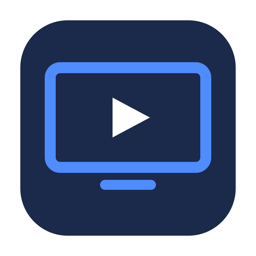

<p align="center"></p>
<h1 align="center">TV Cast</h1>
<p align="center"><b>Play any movie from your computer on your TV, at full original quality, with no lag.</b><br>
4K · HDR · Dolby Vision · Atmos · 10 GB+ files · macOS, Windows, Linux → Fire TV &amp; Android TV</p>

---

Most casting apps **re-encode** video on the fly, which costs quality and causes stutter. TV Cast doesn't.
It sends the **original file** over your Wi-Fi, and the TV's own Kodi player decodes it in hardware.
Your 60 GB 4K remux plays bit-for-bit, with instant seeking.

## Install (one line)

**macOS** (Terminal) and **Linux**:
```bash
curl -fsSL https://raw.githubusercontent.com/TANMAYJAIN18/tvcast/main/install.sh | bash
```

**Windows** (PowerShell):
```powershell
irm https://raw.githubusercontent.com/TANMAYJAIN18/tvcast/main/install.ps1 | iex
```

Run the same command again any time to **update or repair**. Your TVs and settings are kept.

Prefer a manual download? Get the files from [Releases](https://github.com/TANMAYJAIN18/tvcast/releases/latest).
The macOS app isn't notarized by Apple, so after a browser download, right-click **TV Cast → Open** the first time.
The one-line installer avoids that step.

The installer gives you:
- the app (macOS: native app in Applications; Windows: Start menu; Linux: apps menu)
- a **Desktop shortcut**
- a small background engine that starts at login, so the app is always ready and **streaming continues if you close the window**
- on a MacBook, an optional **lid-closed streaming** helper (you're asked once)

## First-time setup (2 minutes, once per TV)

1. **Turn on ADB debugging on the TV**
   - **Fire TV / Fire Stick:** Settings → My Fire TV → About → click the device name 7 times → back → Developer Options → **ADB Debugging: ON**
   - **Android TV / Google TV:** Settings → Device Preferences → About → click *Build* 7 times → back → Developer options → **USB debugging: ON** (and *Network debugging* if shown)
2. Open **TV Cast** and press **Search network**. On the TV, accept **"Allow USB debugging?"** and tick **Always allow**.
3. If the TV has no Kodi, press **Install Kodi**. TV Cast downloads the official build from kodi.tv, checks its SHA-256 checksum, installs it and tunes it.
4. Click any movie. It plays.

## Features

| | |
|---|---|
| **Full quality** | No transcoding: 4K, HDR10/HDR10+, Dolby Vision, DTS-HD/TrueHD/Atmos passthrough, all subtitles |
| **No lag** | Kodi tuned for big files: large read-ahead buffer, refresh-rate matching for smooth 24p |
| **One-click play** | Click a movie, it starts on the TV. Seek bar, pause, ±10/30 s, volume, audio language and subtitles from the computer |
| **Finds everything** | Scans Movies/Videos, Downloads, Desktop, Documents and external drives; add any folder |
| **Finds your TVs** | Network search, add by IP, reconnect, and automatic re-discovery when the router gives a TV a new address |
| **Kodi management** | Install, update (always the latest official release) and optimize Kodi from the app |
| **Stays awake while streaming** | The computer won't sleep while a TV is playing *or paused*; normal sleep when idle |
| **Lid closed** | macOS: optional helper keeps a MacBook streaming with the lid shut, only while streaming, and never below 10 % battery. Linux: automatic (systemd inhibitor). Windows: one click in settings |
| **Self-healing** | Engine restarts itself if it ever stops; restarts a stuck `adb`; recovers from errors instead of crashing |
| **Private and secure** | Everything stays on your network. The control panel only answers this computer; movie links use a random secret; Kodi remote control is password-protected (handled for you) |

## How it works

```
 your computer                                  your TV
┌──────────────────────────┐   Wi-Fi / LAN   ┌──────────────────────┐
│ TV Cast engine (Go)      │ ── original ──▶ │ Kodi (hardware       │
│  • HTTP range streaming  │    file bytes   │  HEVC/AV1/DV decode) │
│  • adb: launch & tune    │ ── adb ───────▶ │                      │
│  • Kodi JSON-RPC control │ ◀─ status ───── │                      │
│ UI: native window (macOS)│                 └──────────────────────┘
│     or browser (Win/Lin) │
└──────────────────────────┘
```

- **Engine** (`engine/`, Go, no dependencies): one codebase for every OS. Streams with `sendfile` and full HTTP Range support; ~300 MB/s on a laptop, far beyond what any 4K movie needs.
- **macOS app** (`macos/`, Swift): native window, menus and Dock icon. The engine runs as a per-user LaunchAgent with automatic restart.
- **adb**: Google's official platform-tools, downloaded automatically on first run if missing.
- **ffprobe** (optional): if installed (`brew install ffmpeg`), shows resolution/HDR/audio badges.

## Tips

- Put the computer on **5 GHz Wi-Fi or Ethernet** for big 4K remuxes (they peak around 80–120 Mbit/s).
- On MacBooks, keep it **plugged in** for long movies with the lid closed.
- Fire TV sleeping? Press a remote button. A sleeping Fire TV may drop off Wi-Fi.
- Something odd? macOS: TV Cast menu → **Restart Engine** or **Show Log**. Logs: `~/Library/Application Support/TVCast/tvcast.log` (Windows: `%AppData%\TVCast`, Linux: `~/.config/TVCast`).

## Uninstall

```bash
# macOS / Linux (keeps settings; add --all to delete them too)
curl -fsSL https://raw.githubusercontent.com/TANMAYJAIN18/tvcast/main/uninstall.sh | bash
```
```powershell
# Windows
irm https://raw.githubusercontent.com/TANMAYJAIN18/tvcast/main/uninstall.ps1 | iex
```

## Build from source

Requires Go 1.22+ (and on macOS, the Xcode Command Line Tools for the app window).
```bash
./build.sh          # everything → dist/
./build.sh mac      # macOS app only
./install.sh        # installs from your local dist/ build
```
Releases are built by GitHub Actions when a `v*` tag is pushed.

## License

MIT
